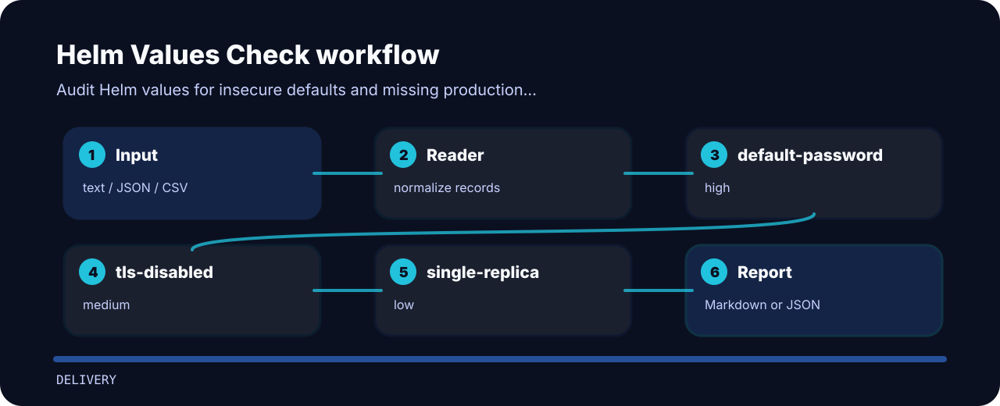

# Helm Values Check

| Detail | Value |
| --- | --- |
| Area | delivery |
| Entry | `helm-values-check` |
| Input | plain text |
| Output | terminal findings, optional JSON |

## What gets flagged

- `default-password` - default password detected (high); use a secret reference.
- `tls-disabled` - TLS is disabled (medium); enable TLS for ingress.
- `single-replica` - single replica configured (low); confirm availability requirements.


## Finding map



## Local check

```bash
git clone https://github.com/mertefekurt/helm-values-check.git
cd helm-values-check
python -m pip install -e ".[dev]"
helm-values-check examples/sample.txt
```
