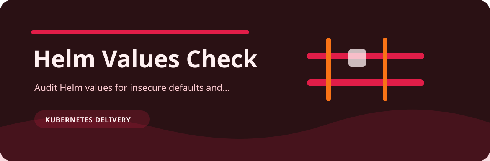

# Helm Values Check



Audit Helm values for insecure defaults and missing production overrides.

## The rule file is the product

- `default-password` (high): default password detected. Fix: use a secret reference.
- `tls-disabled` (medium): TLS is disabled. Fix: enable TLS for ingress.
- `single-replica` (low): single replica configured. Fix: confirm availability requirements.

Everything else in the repo exists to feed records into those checks and render the answer in a way a person can act on.

## Shell session

```bash
git clone https://github.com/mertefekurt/helm-values-check.git
cd helm-values-check
python -m venv .venv
source .venv/bin/activate
python -m pip install -e ".[dev]"
helm-values-check examples/sample.txt
helm-values-check examples/sample.txt --json
```

## Repository shape

```text
.github/        CI workflow
examples/       sample inputs
src/            package source
tests/          test coverage
.gitignore      project file
pyproject.toml  package metadata
```
